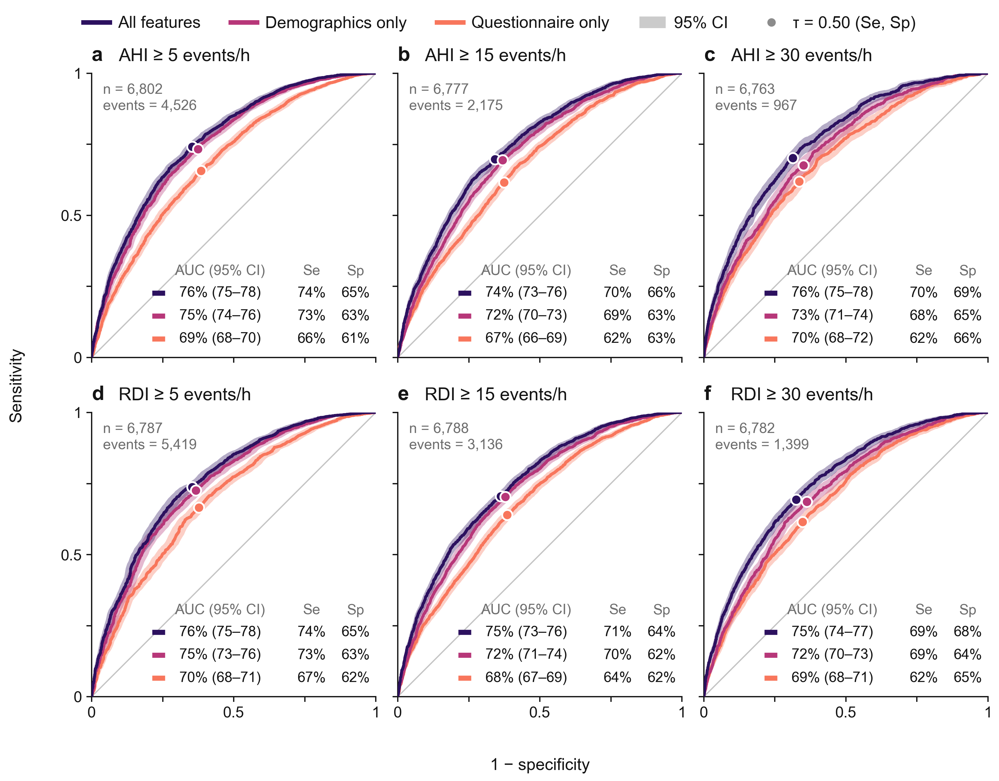
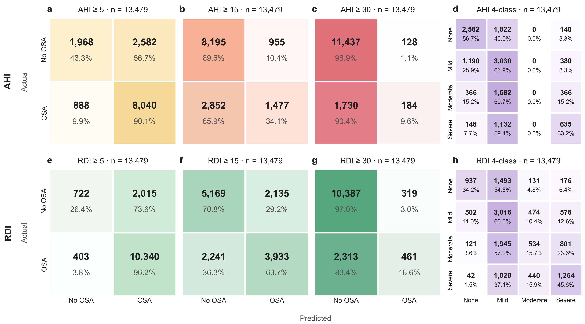
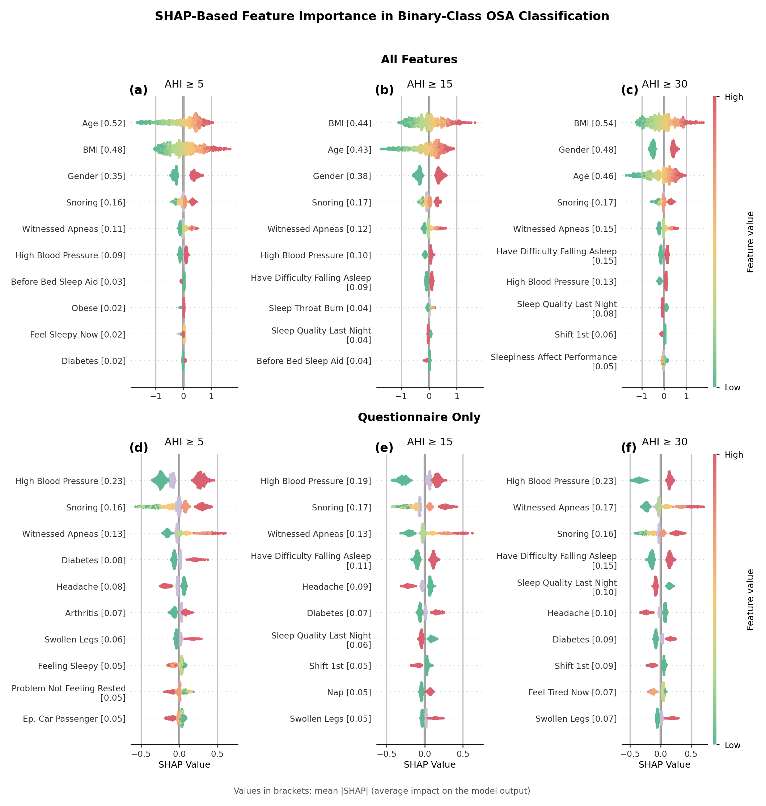
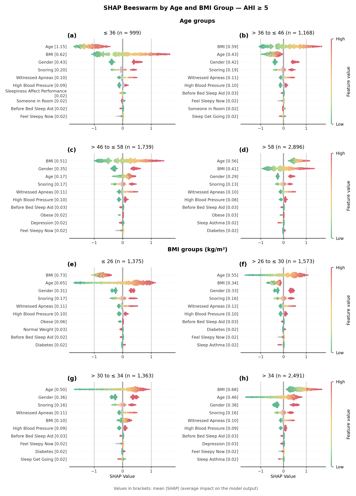
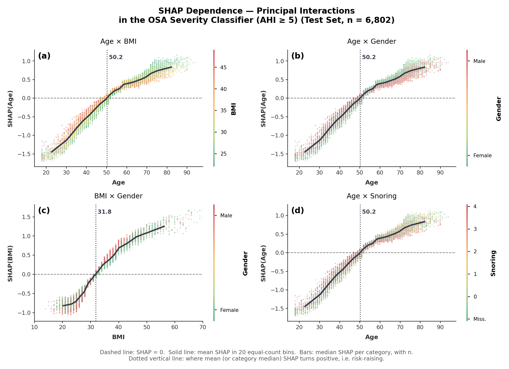

# QuestionnaireOsaSubjectiveBurden

Reproducible analysis pipeline for the manuscript

> **Demographic versus questionnaire-derived predictors of OSA severity:
> a benchmark of XGBoost and TabPFN on 67,397 in-laboratory PSGs.**

The cohort comprises 67,397 adults (age ≥ 18 years) referred for in-laboratory
polysomnography (PSG).  Three feature configurations — *All Features* (169 vars),
*Questionnaire-Only* (~161 vars), and *Demographics-Only* (4 vars: age,
gender, BMI, race) — are compared against AHI/RDI binary thresholds
(5/15/30 events·h⁻¹) and against a 4-class severity target.

Two model families are evaluated:

| Model | Configuration | Output |
|-------|---------------|--------|
| **XGBoost** | Optuna search (100 trials), 90/10 outer split, 5-fold inner CV | `results/training/xgboost_cv_results.pkl` |
| **TabPFN v2.5** | Hyper-parameter-free, 5-fold CV (no held-out test) | `results/training/tabpfn_cv_results.pkl` |

The pickles in `results/training/` are kept (gitignored, regenerate them
yourself or request a copy) so the `manuscript/make_*.py` scripts can
regenerate every figure/table without a full retraining run.

SHAP analysis is reported globally and within predefined age (≤36, 36–46,
46–58, ≥58) and BMI (≤26, 26–30, 30–34, ≥34) strata.

---

## Abstract

**Background.** Validated questionnaires are widely used to screen for obstructive sleep apnea (OSA), yet the incremental value of patient-reported symptom data beyond routinely available demographic variables remains poorly characterised. We aimed to quantify the discriminative contribution of questionnaire-derived items relative to demographic variables alone for OSA severity classification.

**Methods.** We analysed a retrospective cohort of 67,397 adults (aged 18 years or older) referred for in-laboratory polysomnography (PSG). XGBoost classifiers were trained under three feature configurations: All-Features (169 variables), Questionnaire-Only (161 variables), and Demographics-Only (age, gender, BMI, and race; 4 variables). A transformer-based tabular foundation model (TabPFN v2.5) was evaluated as a secondary comparator. Binary classification was assessed at apnea–hypopnea index (AHI) and respiratory disturbance index (RDI) thresholds of 5, 15, and 30 events/h. SHapley Additive exPlanations (SHAP) analysis was performed globally and within predefined age and BMI strata.

**Results.** The Demographics-Only model achieved AUROC values of 0.755, 0.729, and 0.750 at AHI thresholds of 5, 15, and 30 events/h, respectively, differing from the All-Features model by only 0.020–0.033 AUROC units. The Questionnaire-Only model performed worst at all thresholds (AUROC 0.706–0.708), with reductions of 0.054–0.076 relative to the All-Features model. SHAP identified age, BMI, and gender as the three dominant predictors at all thresholds across the full feature set. Stratified analysis revealed a systematic age–BMI interaction: age dominated in younger, leaner patients whereas BMI dominated in those with higher adiposity. Four-class severity classification yielded macro-averaged F1 scores ≤0.40 across all configurations, indicating that fine-grained stratification from non-PSG data remains beyond the resolution of any feature set evaluated.

**Conclusions.** Questionnaire-derived symptom data provides negligible incremental discriminative value for OSA severity classification when demographic information is available. Four readily accessible variables account for the substantial majority of achievable predictive performance, with direct implications for the design of scalable, low-burden screening pathways.

---

## Results

**Figure 1 — ROC curves on the held-out test set (threshold = 0.50)**

<div align="center">
  
</div>

Model performance across six severity thresholds (AHI ≥ 5/15/30 and RDI ≥ 5/15/30). **All Features** (green) consistently outperforms **Demographics Only** (blue) and **Questionnaire Only** (orange) in AUC, sensitivity, and specificity across all thresholds.

**Figure 2 — TabPFN confusion matrices**

<div align="center">
  
</div>

**Figure 3 — SHAP summary, All-Features vs. Questionnaire-Only**

<div align="center">
  
</div>

Age, BMI, and gender dominate the All-Features model; the Questionnaire-Only model has no comparably strong predictor.

**Figure 4 — SHAP importance by age and BMI strata (AHI ≥ 5)**

<div align="center">
  
</div>

Age dominates in younger, leaner patients; BMI dominates in patients with higher adiposity.

**Figure 5 — SHAP dependence, top feature interactions**

<div align="center">
  
</div>

Additional supplementary figures are organized by task under
[`results/figures/`](results/figures/): `feature_importance/` (4-class SHAP),
`feature_importance_stratified/` (extended age/BMI strata),
`feature_interactions/` (extended dependence plots),
`clinical_utility/` (decision-curve analysis), `model_performance/`
(4-class confusion matrix), and `meta_analysis/` (sROC/bivariate summary,
not generated by this repo's code — see that folder for provenance).

---

## Stratification

The 90/10 outer split and the 5-fold inner CV are jointly stratified
on:

* `dem_age` (continuous, bins `[0, 30, 40, 50, 60, 70, 100]`)
* `dem_gender` (categorical)
* `dem_bmi` (continuous, bins `[0, 18.5, 25, 30, 35, 40, 100]`)
* `dem_race`, `sa_sleep_snore`, `sa_sleep_stop_breath`,
  `LAB_CAT`, `MD_Identifyer` (categorical)
* the target itself

This guarantees that every fold and the held-out test set match the
case-mix of the full cohort.

---
___

## Project layout

```
QuestionnaireOsaSubjectiveBurden/
├── config/                 # Path & runtime configuration (single source of truth)
│   └── config.py
├── dataset/                # SQLite database + encoding mappings
│   ├── sleep_research_cleaned.db
│   ├── encoding.json
│   └── README.md
├── results/                # Everything the pipeline generates
│   ├── training/           # Raw .pkl model + CV artefacts (gitignored, regenerate locally)
│   ├── figures/            # Manuscript figures, grouped by the question each answers
│   │   ├── model_performance/            # Figures 1, 2, S4
│   │   ├── feature_importance/           # Figure 3, S5, S6
│   │   ├── feature_importance_stratified/ # Figure 4, S11-S14
│   │   ├── feature_interactions/         # Figure 5, S10
│   │   ├── clinical_utility/             # Figure S15 (decision curves)
│   │   └── meta_analysis/                # S2, S3 (external meta-analysis, not code-generated)
│   └── tables/              # Manuscript tables, same task-based grouping
│       ├── model_performance/   # Table 2, S4, S5, S9, S11 + underlying CSVs
│       ├── tabpfn/              # Table S6 (hand-curated; not regenerated by any script)
│       ├── feature_importance/  # SHAP importance CSVs, interaction ranking
│       ├── clinical_utility/    # Decision-curve + exact-interval CSVs (S12, S13)
│       ├── cohort_description/  # Table S3
│       └── quantification/      # Post-hoc reviewer-response stats (q1-q5)
└── src/questionnaire_osa/  # Importable Python package
    ├── data/               # SQLite loader + feature-set builder
    ├── stratification/     # Multilabel stratified splitter / k-fold
    ├── evaluation/         # Classification metrics + decision_curve.py (net benefit)
    ├── models/             # XGBoost (+Optuna) and TabPFN trainers
    ├── shap_analysis/      # SHAP compute, plots, importance, strata
    ├── plots/              # ROC, confusion, decision-curve figures
    ├── reporting/          # Result-summary CSV / text
    ├── utils/              # Reproducibility helpers
    ├── manuscript/         # Scripts that regenerate one manuscript artefact each
    │   ├── make_table_one.py          # Supplementary Table S3
    │   ├── make_figure1.py            # Figure 1 (ROC)
    │   ├── make_figure2.py            # Figure 2 (confusion matrices)
    │   ├── make_decision_curve.py     # Decision-curve analysis (Figure S15, Tables S12-S13)
    │   ├── make_reference_tables.py   # Reference summary tables
    │   └── make_shared_dataset.py     # Public-release shared dataset export
    ├── train_xgboost.py    # entry point
    ├── train_tabpfn.py     # entry point
    ├── analyze_xgboost.py  # entry point
    └── analyze_tabpfn.py   # entry point
```

All filesystem paths live in **`config/config.py`**.  Scripts never embed
strings of their own; if you need to change a path, change it in one
place.

---

## Installation

### Option A — Conda (recommended)

```bash
conda env create -f environment.yml
conda activate questionnaire_osa
pip install -e .
```

### Option B — pip + virtualenv

```bash
python -m venv .venv
. .venv/Scripts/activate          # Windows: .venv\Scripts\activate
pip install -r requirements.txt
pip install -e .
```

### Windows console encoding

Several reporting modules print `≥` characters. On a default Windows
console (cp1252), this crashes with `UnicodeEncodeError`. Set UTF-8 mode
before running any entry point:

```powershell
$env:PYTHONUTF8 = "1"
```

### TabPFN authentication

TabPFN v2.5 requires a Prior Labs token.  Set it before running:

```bash
# Windows (PowerShell)
$env:TABPFN_TOKEN = "your-token-here"

# Linux / macOS
export TABPFN_TOKEN=your-token-here
```

---

## Reproducing the manuscript

The pipeline is split into four entry points; each is invoked as a
module so that the package's `config/` is on the path.  None take CLI
arguments — every knob lives in `config/config.py`.

```bash
# 1. Train all 24 XGBoost models  (≈ 5–6 h, CPU)
python -m questionnaire_osa.train_xgboost

# 2. Cross-validate TabPFN v2.5 across all 8 targets  (≈ 30–60 min, GPU)
python -m questionnaire_osa.train_tabpfn

# 3. Regenerate every XGBoost figure & table from the pickle
python -m questionnaire_osa.analyze_xgboost

# 4. Regenerate TabPFN figures
python -m questionnaire_osa.analyze_tabpfn
```

Steps 1 and 2 produce `results/training/*.pkl`; steps 3 and 4 read those
pickles and emit exploratory/diagnostic plots and tables (gitignored,
archived under `_local/`). The curated, manuscript-numbered figures and
tables under `results/figures/<task>/` and `results/tables/<task>/` are
regenerated from the same pickles by the scripts in
`src/questionnaire_osa/manuscript/`, e.g.:

```bash
python -m questionnaire_osa.manuscript.make_figure1
python -m questionnaire_osa.manuscript.make_figure2
python -m questionnaire_osa.manuscript.make_table_one
python -m questionnaire_osa.manuscript.make_decision_curve
python -m questionnaire_osa.manuscript.make_reference_tables
```

All artefacts are deterministic given a fixed seed (default `42`).

---

## Targets

8 targets, defined in `config.config.TARGETS`:

| Key | Database column | Type | Group | Description |
|-----|-----------------|------|-------|-------------|
| `ahi_5` | `osa_binary_numeric` | binary | AHI | AHI ≥ 5 |
| `ahi_15` | `osa_binary_fifteenth_numeric` | binary | AHI | AHI ≥ 15 |
| `ahi_30` | `osa_binary_thirty_numeric` | binary | AHI | AHI ≥ 30 |
| `rdi_5` | `osa_binary_numeric_rdi` | binary | RDI | RDI ≥ 5 |
| `rdi_15` | `osa_binary_fifteenth_numeric_rdi` | binary | RDI | RDI ≥ 15 |
| `rdi_30` | `osa_binary_thirty_numeric_rdi` | binary | RDI | RDI ≥ 30 |
| `ahi_4class` | `osa_four_numeric` | multiclass | AHI | AHI 4-class severity |
| `rdi_4class` | `osa_four_numeric_rdi` | multiclass | RDI | RDI 4-class severity |

---


## Repository

[github.com/GiorgioRicciardiello/QuestionnaireOsaSubjectiveBurden](https://github.com/GiorgioRicciardiello/QuestionnaireOsaSubjectiveBurden)

## License

MIT — see [`LICENSE`](LICENSE).

## Citation

If you use this code or its results, please cite the associated
manuscript (citation details to be added on publication).
